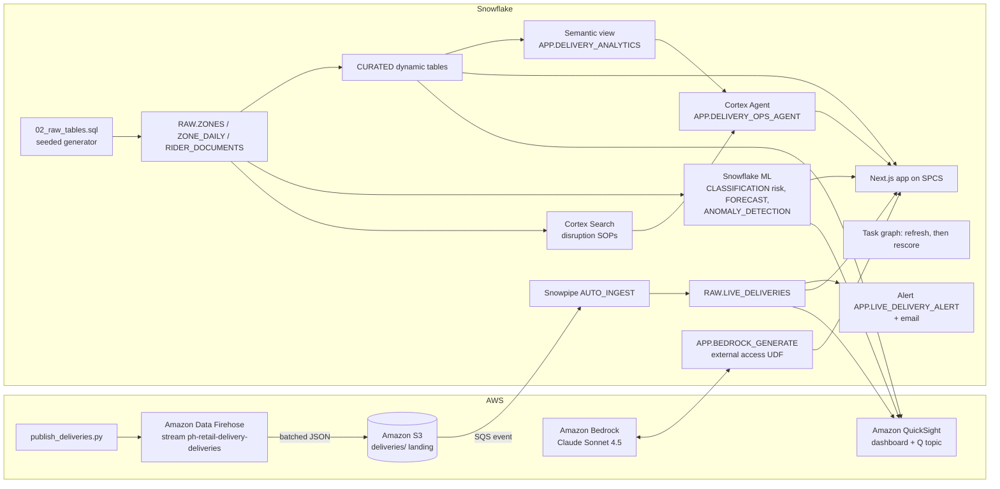

# Philippines Last-Mile Delivery Operations - Failed Deliveries and Disruption Risk

End-to-end last-mile operations for **40 delivery zones of a fictional Philippine e-commerce courier across 5 cities** (Quezon City, Caloocan City, Cebu City, Davao City, Cagayan de Oro City) and 5 services (same-day, next-day, cash on delivery, bulky item, inter-island) using Snowflake, optionally with AWS: from a live failed delivery attempt to a 7-day delivery-disruption risk score, an alert email and an AI action memo for the last-mile operations team.

## Architecture

A last-mile operations pipeline built on **Snowflake** (Dynamic Tables, Snowflake ML, Cortex Search, Cortex Agent, Cortex AI_COMPLETE, SPCS) and, in the full build, **AWS** (Amazon Data Firehose, S3, Bedrock Claude, QuickSight + Amazon Q). Delivery-attempt events land in `RAW.LIVE_DELIVERIES`. Dynamic tables curate 90 days of zone-day history: parcels dispatched, delivered parcels, failed deliveries, returns to sender, delivery disruption hours, delivered value in PHP and rider payout timeliness. Snowflake ML scores 7-day delivery-disruption risk per zone, forecasts network-wide failed deliveries and flags hub-to-door time anomalies. A Cortex Agent answers questions with SOP citations, and an LLM drafts the operations action memo.

Interactive diagrams (hover for object names): [Snowflake only](docs/architecture-snowflake.html) | [AWS + Snowflake](docs/architecture-aws.html). The app shows both on its Architecture & Data tab, the current build first. Regenerate them with `python3 docs/build_architecture.py aws` and `python3 docs/build_architecture.py snowflake`.



The Snowflake-only build drops the AWS subgraph: `APP.SIMULATE_DELIVERIES` writes to `RAW.LIVE_DELIVERIES`, and the app calls Cortex `AI_COMPLETE` instead of the Bedrock UDF.

## Snowflake Capabilities

| Capability | Implementation |
|-----------|---------------|
| Dynamic Tables | `CURATED.KPI_SUMMARY`, `PERFORMANCE_SUMMARY`, `CAUSE_SUMMARY`, `TREND_ANALYSIS` from the RAW tables |
| Snowflake ML | CLASSIFICATION 7-day delivery-disruption risk (`ML.DISRUPTION_RISK_SCORES`), 14-day failed-delivery FORECAST, hub-to-door time ANOMALY_DETECTION |
| Cortex Search | 18 synthetic delivery disruption SOPs (one per service and disruption cause) in `SEARCH.PLAYBOOK_SEARCH` |
| Semantic View | `APP.DELIVERY_ANALYTICS` over zones, disruption causes, daily totals and risk |
| Cortex Agent | `APP.DELIVERY_OPS_AGENT`: Cortex Analyst over the semantic view plus Cortex Search for SOP citations |
| Cortex AI | `AI_COMPLETE('claude-sonnet-4-5')` for grounded answers, and for the action memo in the Snowflake-only build |
| Alerts + Tasks | `APP.LIVE_DELIVERY_ALERT` logs FAILED attempts and sends email; task graph `TASK_REFRESH_CURATED`, then `TASK_RESCORE_RISK` |
| Snowpark Container Services | Next.js app `APP.PH_RETAIL_DELIVERY_APP` with 6 tabs: Executive Cockpit, Predictive, Controls, Live Deliveries, Ask AI, Architecture & Data |
| Snowpipe | `RAW.LIVE_DELIVERIES_PIPE` AUTO_INGEST from S3 (AWS build only) |

## AWS Services

Used only in the AWS + Snowflake build.

| Service | Role in Demo |
|---------|-------------|
| Amazon Data Firehose | Direct PUT stream `ph-retail-delivery-deliveries` receives simulated delivery-attempt events and writes batches to S3 |
| Amazon S3 | Landing bucket (`deliveries/`). An event notification goes to the Snowpipe SQS queue |
| Amazon Bedrock | Claude Sonnet 4.5 writes the action memo, called from Snowflake through an external-access UDF |
| Amazon QuickSight | DIRECT_QUERY executive dashboard over Snowflake (daily failed deliveries, disruption hours by zone, delivery-disruption risk) |
| Amazon Q | Natural-language questions over the QuickSight topic `ph-retail-delivery-topic` |
| AWS IAM | Least-privilege roles for S3, Firehose and Bedrock |

## Personas

These personas are fictional.

| Persona | Role | Key Questions |
|---------|------|---------------|
| **Marisol Bautista** | VP Last-Mile Operations | "What is our delivery success rate across cities and services?" "Which disruption causes cost us the most failed deliveries?" |
| **Paolo Dizon** | Hub Network & Rider Capacity Lead | "Which zones are at risk of a delivery disruption this week, and which SOP applies?" |

## Data

All data is synthetic and seeded, so every rebuild reproduces it. The courier, its zones, hubs and people are fictional; the cities are real Philippine cities used as regions.

| Table | Rows | Description |
|-------|------|-------------|
| RAW.ZONES | 40 | Delivery zones: one of 5 services (Same-day, Next-day, Cash on delivery, Bulky item, Inter-island) in one of 5 cities, with last-mile access tier and rider payout cycle |
| RAW.ZONE_DAILY | 3,600 | Daily zone observations over 90 days: parcels dispatched, delivered parcels, failed deliveries, returns to sender, delivered value (PHP), disruption hours and cause, rider payouts due and settled, average attempts per parcel and average hub-to-door hours |
| RAW.RIDER_DOCUMENTS | 40 | Required, on-file and pending rider compliance checks per zone (licence, truck registration, COD cash-handling and waybill training) |
| SEARCH.PLAYBOOK_DOCS | 18 | Synthetic delivery disruption SOPs indexed for Cortex Search |
| RAW.LIVE_DELIVERIES | Grows during the demo | Live delivery-attempt events from Firehose (AWS build) or `APP.SIMULATE_DELIVERIES` (Snowflake-only build) |
| ML.DISRUPTION_RISK_SCORES | 40 | 7-day delivery-disruption probability and risk band per zone |

## Build Instructions

### Prerequisites
- Snowflake account with ACCOUNTADMIN access, and Cortex AI enabled (AI_COMPLETE, Search, Agent).
- An X-Small warehouse with auto-suspend at or below 120 s, and an existing SPCS compute pool.
- Python 3.11+, `snowflake-connector-python`, Node.js 22+, Docker and the `snow` CLI.
- App image: run `snow spcs image-registry login`, then build and push `ph-retail-delivery-app:v1` to the database's `APP.IMAGES` repository (see the header of `snowflake/07_deploy_app.sql`).
- AWS build only: `boto3`, AWS credentials for the target account (us-west-2) with Bedrock access, and QuickSight Enterprise.

### SPCS App
```
<DATABASE>.APP.PH_RETAIL_DELIVERY_APP
```

### Tests
```bash
python -m pytest aws snowflake quicksight
```

For a local run, put `SNOWFLAKE_ACCOUNT`, `SNOWFLAKE_USER`, `SNOWFLAKE_DATABASE`, `SNOWFLAKE_WAREHOUSE`, `SNOWFLAKE_AUTHENTICATOR=PROGRAMMATIC_ACCESS_TOKEN`, `SNOWFLAKE_TOKEN` and `DEMO_PLATFORM` in the environment, then run `npm --prefix app run build && npm --prefix app start`.

## Build Modes

Both modes share the same core. They differ in three places, and the app's `DEMO_PLATFORM` setting (in its SPCS spec) switches the memo provider and the Live Deliveries tab.

| Layer | Snowflake Only | Full AWS + Snowflake |
|---|---|---|
| Live delivery attempts | `CALL APP.SIMULATE_DELIVERIES(n)` inserts simulated delivery-attempt events into `RAW.LIVE_DELIVERIES`. This simulates an attempt feed; it is not Snowpipe Streaming | `aws/publish_deliveries.py` to Amazon Data Firehose, then S3, SQS and Snowpipe AUTO_INGEST |
| Action memo | Cortex `AI_COMPLETE('claude-sonnet-4-5')` | Amazon Bedrock Claude Sonnet 4.5 through `APP.BEDROCK_GENERATE` |
| BI and natural-language questions | The SPCS app is the dashboard; questions go to the Cortex Agent | Also a QuickSight dashboard and an Amazon Q topic |
| App setting | `DEMO_PLATFORM: snowflake` | `DEMO_PLATFORM: aws` |

### Snowflake Only

```bash
# 1. Core data and dynamic tables (guarded: new isolated database only)
python snowflake/run_core.py --database PHILIPPINES_RETAIL_DELIVERY_SNOWFLAKE --warehouse <XS_WAREHOUSE> --connection <CONNECTION> --apply
# 2. Native delivery feed, ML, search, semantic view, agent, alert and task graph
python snowflake/run_intelligence.py --database PHILIPPINES_RETAIL_DELIVERY_SNOWFLAKE --platform snowflake --warehouse <XS_WAREHOUSE> --connection <CONNECTION> --alert-email you@example.com
# 3. App on SPCS with DEMO_PLATFORM=snowflake (push the image first)
python snowflake/run_intelligence.py --database PHILIPPINES_RETAIL_DELIVERY_SNOWFLAKE --platform snowflake --warehouse <XS_WAREHOUSE> --connection <CONNECTION> --alert-email you@example.com --files 07_deploy_app.sql --compute-pool <COMPUTE_POOL>
```

During the demo:
- Run `CALL APP.SIMULATE_DELIVERIES(20)` to add live delivery attempts. For a continuous feed, run `ALTER TASK APP.TASK_SIMULATE_DELIVERIES RESUME`, and `SUSPEND` it afterwards.
- Run `EXECUTE ALERT APP.LIVE_DELIVERY_ALERT` to raise the alert email.
- Run `EXECUTE TASK APP.TASK_REFRESH_CURATED` to refresh the curated tables and rescore risk.

Afterwards, drop the database or run `ALTER SERVICE APP.PH_RETAIL_DELIVERY_APP SUSPEND`.

### Full AWS + Snowflake

```bash
# 1. Core data and dynamic tables (guarded: new isolated database only)
python snowflake/run_core.py --database PHILIPPINES_RETAIL_DELIVERY_AWS --warehouse <XS_WAREHOUSE> --connection <CONNECTION> --apply
# 2. AWS ingestion and Bedrock (dry run first, then --apply)
python aws/setup_aws.py --database PHILIPPINES_RETAIL_DELIVERY_AWS --account <AWS_ACCOUNT_ID> --connection <CONNECTION> --apply
# 3. ML, search, semantic view, agent, alert and task graph
python snowflake/run_intelligence.py --database PHILIPPINES_RETAIL_DELIVERY_AWS --platform aws --warehouse <XS_WAREHOUSE> --connection <CONNECTION> --alert-email you@example.com
# 4. App on SPCS with DEMO_PLATFORM=aws (push the image first)
python snowflake/run_intelligence.py --database PHILIPPINES_RETAIL_DELIVERY_AWS --platform aws --warehouse <XS_WAREHOUSE> --connection <CONNECTION> --alert-email you@example.com --files 07_deploy_app.sql --compute-pool <COMPUTE_POOL>
# 5. QuickSight dashboard and Q topic (needs an existing Snowflake data source)
python quicksight/build_dashboards.py --database PHILIPPINES_RETAIL_DELIVERY_AWS --account <AWS_ACCOUNT_ID> --principal-arn <QUICKSIGHT_USER_ARN> --data-source-arn <DATA_SOURCE_ARN> --prefix ph-retail-delivery --apply --update --with-topic
```

QuickSight objects must be shared with the QuickSight user who signs in (`--principal-arn`); otherwise the console shows nothing.

During the demo:
- Run `python aws/publish_deliveries.py --count 20` to send live delivery-attempt events. Firehose buffers for up to 60 seconds before writing to S3.
- Run `EXECUTE ALERT APP.LIVE_DELIVERY_ALERT` to raise the alert email.
- Run `EXECUTE TASK APP.TASK_REFRESH_CURATED` to refresh the curated tables and rescore risk.

Afterwards, `python aws/teardown_aws.py --database PHILIPPINES_RETAIL_DELIVERY_AWS --account <AWS_ACCOUNT_ID> --connection <CONNECTION> --apply` removes the AWS resources and the account-level Bedrock external-access and S3 storage integrations. It leaves the email integration `PH_RETAIL_DELIVERY_EMAIL_INT`, which the Snowflake-only build also uses.

## Business Impact

Industry research and Snowflake customer outcomes:
- **Southeast Asia e-commerce, the main source of last-mile parcel volume**: "E-commerce, poised to reach $159 billion GMV by 2024, is now driven primarily by existing customers who account for up to 70% of expansion" -- [Temasek, e-Conomy SEA 2024 report press release](https://www.temasek.com.sg/en/news-and-resources/news-room/news/2024/-e-conomy-sea-2024-report--profitability-push-in-southeast-asia-)
- **Video commerce is changing how parcels are ordered**: "Video commerce has surged to 20% of e-commerce GMV, up from less than 5% in 2022" -- [Temasek, e-Conomy SEA 2024 report press release](https://www.temasek.com.sg/en/news-and-resources/news-room/news/2024/-e-conomy-sea-2024-report--profitability-push-in-southeast-asia-)
- **Penske Logistics** (Snowflake customer, supply chain and logistics), where data plays "a critical role in optimizing routes, ensuring the seamless flow of goods and reducing disruptions", reports "<15 days to build a new AI summarization model" with Cortex AI, and its business analysts "create BI reports with companywide data spanning five years in just 15 minutes" -- [Snowflake customer story: Penske](https://www.snowflake.com/en/customers/all-customers/case-study/penske/)

## Key Demo Numbers

These figures are synthetic and come from the seeded demo data. Forecast and anomaly figures can shift slightly with the build day.

- **40 delivery zones** across 5 cities and 5 services, 3,600 zone-days over 90 days; **5,977,704 parcels dispatched**, **5,603,603 delivered** and delivered value of PHP 5,338 M
- **Delivery success rate 93.7%**: **183,291 failed deliveries** went back to the hub, and the return to sender rate is 3.2% (190,810 parcels)
- **493 delivery disruption hours** on **167 disruption zone-days**; hub backlog causes the most (112 hours on 34 zone-days), and the two typhoon flooding days add 80 hours on 16 zone-days
- **Delivery-disruption model** out-of-time holdout (592 zone-days): precision 0.40, recall 0.41 at a 0.5 threshold, against a 0.21 base rate. Nine zones are high risk; the top zone is ZON-0036, at 84.9%
- **14-day failed-delivery forecast** with prediction intervals; **25 of 640** zone-days flagged as hub-to-door time anomalies
- **Rider payout on-time rate 77.9%**, rider document coverage 58.7%, with 26 checks pending
- **18 SOPs** indexed for Cortex Search and cited by ID in agent answers

## License

Apache 2.0 — See [LICENSE](LICENSE) for details.

This is a personal demo project and is not an official Snowflake offering. It comes with no support or warranty. Industry metrics cited are from publicly available third-party research and Snowflake customer stories; they represent reported outcomes and are not guarantees of results.
